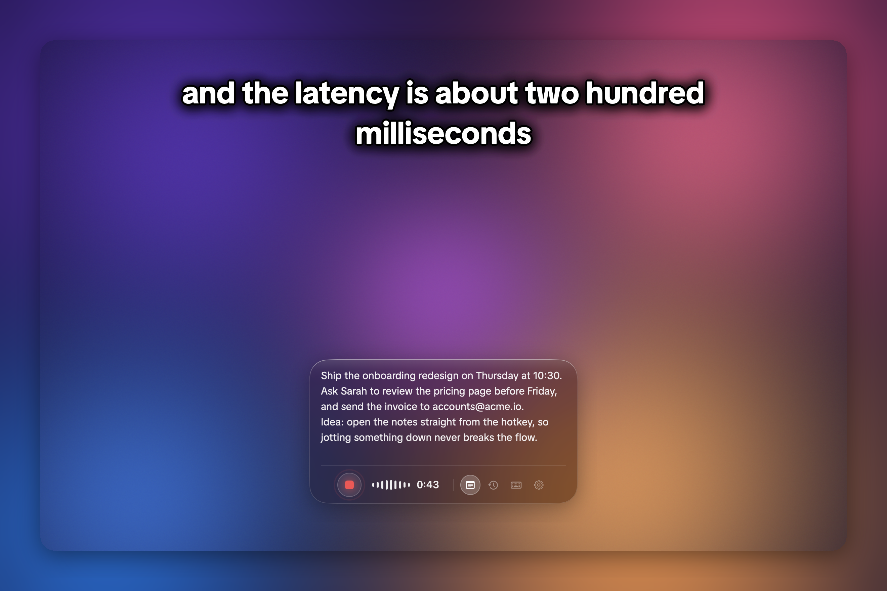
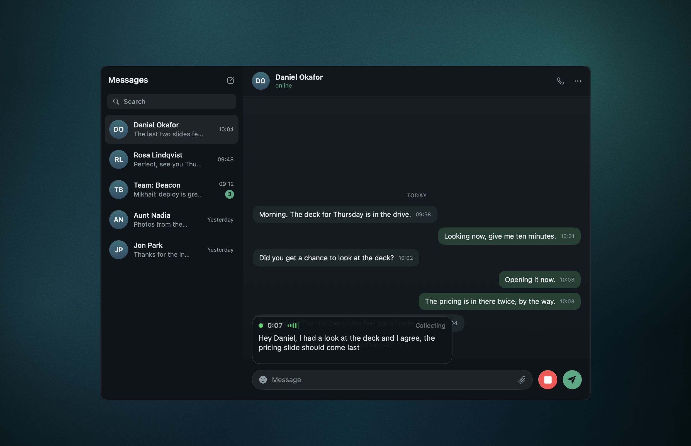
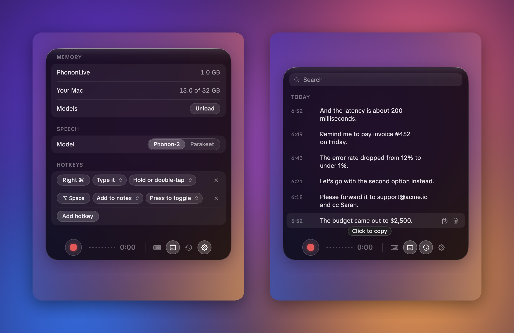

# Iridium Live

Dictation app for macOS. Speech recognition runs locally on the GPU with
[Phonon-2](https://huggingface.co/FermionResearch/Phonon-2), or on Vegeta through the Citadel API.



## Features

- **Captions:** live text at the top or bottom of the screen the pointer is on.
- **Typing** into the app in front. Misheard words are fixed while you speak. Apps that lose typed keys, such as Tern,
  get each sentence as one paste instead (Settings, Typing, Paste into); your clipboard comes back right after. The
  record button starts the moment it is pressed.
- **Sounds:** a short sound when recording starts, when you release, and when the text is typed (Settings, Typing,
  Sounds: Nib, Wood or Tape, or Off). Each is a struck object modelled in `Resources/Sounds/synth.py`, in four takes
  that never play the same one twice in a row.
- **Notes:** dictate into a note and edit it like any text. Saved notes are in My notes. With a cleanup key, a take
  is filed by topic about 20 s after you stop: each part goes to the note it belongs to or starts a new one, with
  tags, and a notice shows where it went, with Undo. Tags can be edited; My notes filters by tag and sorts by
  recent, title or tag. Settings, Notes, File takes by topic.
- **Hotkeys:** hold, double-tap or toggle. Several hotkeys can share a key.
- **Microphone:** the MacBook's own. While the lid is closed, your default input, such as AirPods or a USB microphone.
  If no sound arrives, the status line says so.
- **WhatsApp and Telegram:** a record button in the chat window. Stream mode types while you speak. Collect mode
  inserts the whole message at the end and can send it.
- **AI cleanup** (optional, Groq, OpenRouter or Vegeta): removes filler words and formats numbers, dates and links.
  Custom instructions.
- **Vegeta** (optional, Albastov key): Settings, Speech, Vegeta sends each phrase to Citadel's
  `/v1/audio/transcriptions` and loads no speech model on this Mac. Phrases come back in the order they were spoken;
  captions ask at most once a second. When Vegeta is offline, busy past its queue timeout or slower than the speech
  timeout, the take is finished on this Mac with Phonon-2 (or fails with Retry, `vegetaFallback: "fail"`), and the
  next take tries Vegeta again. Cleanup can run on Vegeta too, with any model from Citadel's `GET /v1/models`; when a
  recording starts (at most once a minute) a one-token request goes out, so a model Vegeta unloaded while idle is
  loaded again while you speak. History shows the round trip where it shows decoding time for this Mac.
- **Vegeta Live** (optional, Albastov key): the same as Vegeta, over one WebSocket instead of an HTTP call per
  phrase. Settings, Speech, Vegeta Live: when a recording starts the app opens a session at Citadel
  (`POST /v1/dictation/sessions`) and the socket it names, keeps it open while you speak and a minute after, and sends
  each phrase (and the captions, twice a second) as 16 kHz PCM. Cleanup provider Vegeta Live sends the same cleanup,
  correction, polish and warm-up requests over the same socket and gets the answer streamed. A dropped socket is
  reopened and what was not answered is sent again. When it cannot be opened, or dies, the rest of that recording goes
  the Vegeta way (HTTP, then this Mac as `vegetaFallback` says) and the status line says "Vegeta Live dropped: using
  Vegeta"; the next recording tries the socket again. History shows the Vegeta Live round trip, Vegeta's own timings
  (queued, inference) and, for cleanup, the time to the first token. `python replay.py take.wav` plays a recording
  through the engine on Vegeta Live and prints, per phrase, end of speech to corrected text.
- **Models window:** every OpenRouter model and provider with latency, throughput, price, context and uptime, measured
  per provider. Sort, resize, reorder, show or hide any column. Star a model and provider to save it to My models,
  then pick from the last three in Settings.
- **Corrections:** say "Let's meet on Tuesday", then "I mean Wednesday", and "Tuesday" becomes "Wednesday", also in
  the typed text. Works with correction keywords such as "I mean", "no wait" and "scratch that".
- **Add quotes** (optional): "quote … end quote" becomes quotation marks.
- **When cleanup fails:** retry, fail and notify, or insert the raw text. An answer cut off at its length limit, or
  containing model markers such as `<EOS_TOKEN>`, is never typed; what you said is typed instead. Once a phrase has
  failed, the next ones get one try each until the provider answers again. Turning cleanup off or picking another
  provider counts from the next phrase, even mid-retry.
- **History:** every recording, searchable, with timing and cost. A recording is saved to disk while you speak, so
  nothing is lost if the model is slow to load, the engine stops or the app quits: it shows as failed, with Retry.
  Text that arrives after its recording stopped is typed only if nothing has moved since: the same app in front, no
  newer recording, no key pressed or click made. Otherwise it waits in History and the status line says why. Play
  what you said, retry the cleanup of any entry or add it to the current note.
- **Event log:** every decision about a recording, one line each: what the app asked the engine, what heard and
  cleaned each phrase, and why text was or was not typed. Open it from the menu (Event log).
- **Corrections window:** what the AI cleanup read and changed for each recording: the earlier sentences it used in
  orange, and every change as a word diff, live while you dictate. Open it from the menu or a history row.
- **Out of the way:** right-click the control to make it compact (one thin line) or hide it for 15 minutes, an hour
  or until you show it again. Hotkeys keep working while it is hidden.
- **Menu bar icon:** start dictation, record a meeting, show or hide the control, quit. It turns red while recording.





## Meetings

Record a meeting with your microphone and the other side of the call, with a live transcript while it runs and a
full transcript with speakers afterwards. The meeting button in the bar opens the meeting pane, where you choose the
microphone, system audio and engine and press Record. While a meeting records, a strip under the bar shows the time
and the last thing said, with Pause and Stop, even with the pane closed. Dictation keeps working during a meeting,
and the live transcript leaves out what your microphone picks up from your speakers.
Speakers can be renamed and merged, lines can be edited and played back, and a meeting can be exported as Markdown,
SRT, VTT or text.

A meeting can be recorded now and transcribed later: Settings, Meetings, When it ends, Transcribe or Later, and Live
transcript off for nothing running while you record. A microphone that drops out or changes mid-meeting is picked up
again; the meeting keeps recording the other side meanwhile.

Engines: Apple on this Mac (default), Parakeet on this Mac, or ElevenLabs, AssemblyAI and Deepgram with a key. Any
meeting can be transcribed again with another engine. The live transcript uses Apple on device speech. Summaries,
action items and chat use OpenRouter or Anthropic.

Meetings live in `~/Library/Application Support/Iridium Live/Meetings`, one folder per meeting with its audio,
transcript and summary. Meetings from the old Iridium app are copied in once, after first launch.

## Numbers

M1 Max, 32 GB.

| | |
|---|---|
| Speed | 79x realtime |
| Word error rate | 8.18% (Open ASR Leaderboard, 300 clips) |
| Phonon-2 vs Parakeet TDT v3 | 9.28% vs 9.27% word error rate, 86x vs 58x realtime |
| Pause that splits speech | 0.7 s |
| Cleanup, Groq with Qwen3.8 27B | 143 ms median |
| Corrections test, Qwen3.8 27B on Cerebras (OpenRouter) | 22 of 22 corrections right, 0 wrong edits, 0 of 20 look-alikes changed, 284 ms median |
| Memory | 1.0 GB with the speech model loaded, 0.5 GB unloaded |
| Speech model ready | Parakeet 1.5 s, Phonon-2 0.7 s |

English only.

## Install

Requirements: Apple silicon, macOS 26, Xcode command line tools, [uv](https://docs.astral.sh/uv/).

```sh
git clone https://github.com/SignedAdam/iridium-live
cd iridium-live
make install   # build and copy to /Applications
make run       # run from the terminal
make check     # print the paths the app uses
make cert      # create a local signing certificate, so permissions survive rebuilds
```

On first launch the app asks for Microphone and Accessibility access. API keys are optional and stored in the login
keychain. The speech model (about 1 GB) downloads on first use.

## Privacy

- Audio stays on your Mac. Each recording is written while you speak and deleted once transcribed, unless Keep audio
  is on. Failed recordings keep theirs.
- With AI cleanup on, text is sent to Groq, OpenRouter or Citadel (Vegeta): the new text, the earlier text of the
  same recording, and the end of the current note. Filing notes by topic sends the new note text and the titles and
  tags of your notes.
- With Vegeta or Vegeta Live as the speech model, the audio of each phrase is sent to Citadel.

## Files

`~/Library/Application Support/Iridium Live`

| | |
|---|---|
| `settings.json` | settings, see below |
| `notes.txt` | unsaved note |
| `Notes/` | saved notes |
| `journal.txt` | everything dictated, in order |
| `backups/` | earlier versions of notes |
| `history.jsonl` | history with timing |
| `usage.jsonl` | AI model calls: tokens, cost, time |
| `Recordings/` | one file per recording; `takes.jsonl` tracks the ones still in progress |
| `Meetings/` | one folder per meeting: audio, transcript, summary |
| `chat-apps.json` | chat app settings |

Event log: `~/Library/Logs/Iridium Live/events.log` (menu, Event log). Engine log: `~/Library/Logs/Iridium Live/engine.log`

## Settings file

Settings are in `~/Library/Application Support/Iridium Live/settings.json`, pretty-printed with sorted keys, one key
per setting. To change one by hand: quit Iridium Live, edit the file, open the app again (the app reads it only at
launch, and writes it on every change in Settings). Keys the app does not know are kept.

If the file does not parse, the app says so in the status line, runs on the last good settings
(`settings.last-good.json`) and leaves the file as it is until the next launch; fix it and reopen. The first launch
with no file writes it from the settings of earlier versions.

For Vegeta:

| Key | Default | |
|---|---|---|
| `speechModel` | `"phonon-2"` | `"vegeta"` transcribes on Vegeta, `"vegeta-live"` on Vegeta over the live stream; also `"parakeet"` |
| `vegetaSpeechModel` | `"parakeet"` | Citadel's speech model (HTTP path only; the live stream has its own) |
| `vegetaSpeechTimeoutS` | `8` | longest wait for one phrase before the fallback; on Vegeta Live, before the HTTP path |
| `vegetaFallback` | `"local"` | `"local"`: finish the take with Phonon-2 on this Mac; `"fail"`: History shows it failed, with Retry |
| `cleanupProvider` | `"openrouter"` | `"vegeta"` cleans up on Vegeta, `"vegeta-live"` the same over the live stream |
| `cleanupModels` | `{}` | per provider; `"vegeta"` takes a model id from Citadel's `GET /v1/models`, `"vegeta-live"` the same (Vegeta's when unset) |
| `cleanupTimeoutS` | `{"groq": 2.5, "openrouter": 2.5, "vegeta": 4, "vegeta-live": 4}` | longest cleanup of one phrase, per provider, 0.5 to 30 s |

To undo Vegeta Live: `speechModel` and `cleanupProvider` back to `"vegeta"` (or any other).

The Albastov key (`CITADEL_API_KEY`) is in the login keychain like the other keys: Settings, Setup.


Keys work the same way: put `keys.json` (`{"citadel": "…"}`, ids as in `Sources/Keychain.swift`) next to `settings.json` while the app is closed. At launch the app moves them into the Keychain and deletes the file.

## Code

| | |
|---|---|
| `Sources/` | the app (SwiftUI) |
| `live.py` | the speech engine (Python, MLX), run by the app as a child process |
| `segmenter.py` | voice detection; splits speech at pauses |
| `asr.py` | Phonon-2 and Parakeet |
| `vegeta.py` | speech to text on Vegeta through Citadel, with Phonon-2 on this Mac as the fallback |
| `vegeta_live.py` | the Vegeta Live session: one WebSocket for speech to text and cleanup, reopened on a drop |
| `cleanup.py` | AI cleanup with Groq, OpenRouter and Vegeta |
| `replay.py` | plays a recording through the engine on Vegeta Live and prints the time per phrase |
| `tests/` | Python tests (`make test`); `tests/stream_stub.py` stands in for Citadel and the stream |
| `takes.py` | saves every recording while you speak |
| `downloads.py` | downloads the speech model |
| `Resources/Sounds/synth.py` | makes the sounds: `python Resources/Sounds/synth.py Resources/Sounds` (numpy, scipy, soundfile) |
| `Packages/ModelCatalog` | Swift package: `OpenRouterCatalog` (models, providers, stats) and `SortableTable` (sortable SwiftUI table) |
| `Packages/MeetingKit` | Swift package: meeting recording, transcription, summaries |

## Credits

- [Phonon-2](https://huggingface.co/FermionResearch/Phonon-2) by Fermion Research (CC-BY-4.0), from NVIDIA's
  [Parakeet TDT 0.6B v3](https://huggingface.co/nvidia/parakeet-tdt-0.6b-v3) (CC-BY-4.0)
- [Silero VAD](https://github.com/snakers4/silero-vad) (MIT)
- [mlx-audio](https://github.com/Blaizzy/mlx-audio) (MIT)
- [TikTok Sans](https://github.com/tiktok/TikTokSans) (SIL Open Font License, in `fonts/`)
- [LobeHub icons](https://github.com/lobehub/lobe-icons) (MIT, in `Packages/ModelCatalog/Brands/`): model maker and
  provider logos
- [FluidAudio](https://github.com/FluidInference/FluidAudio) (Apache 2.0): speaker detection and Parakeet for
  meetings

## License

MIT, see [LICENSE](LICENSE). The font, icons and models above keep their own licenses.
