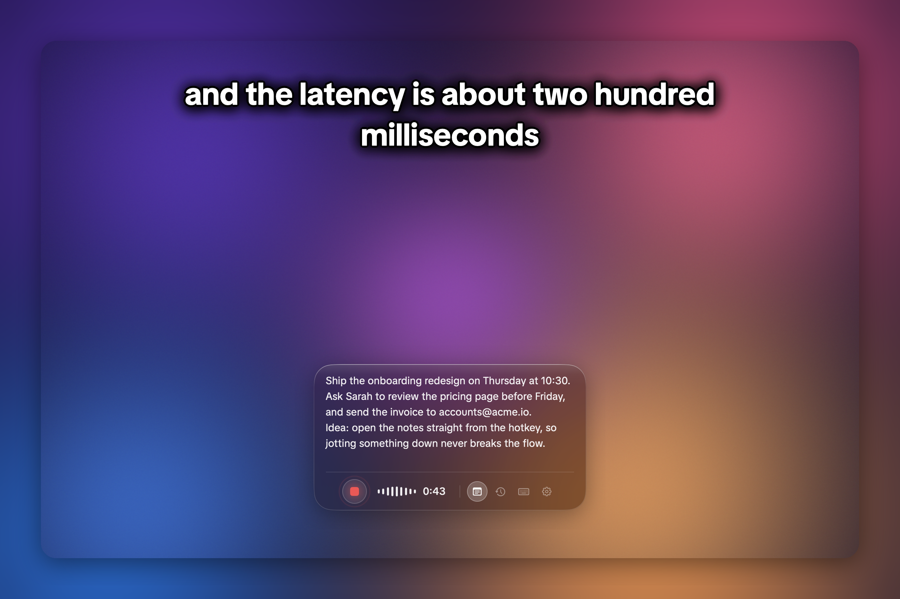
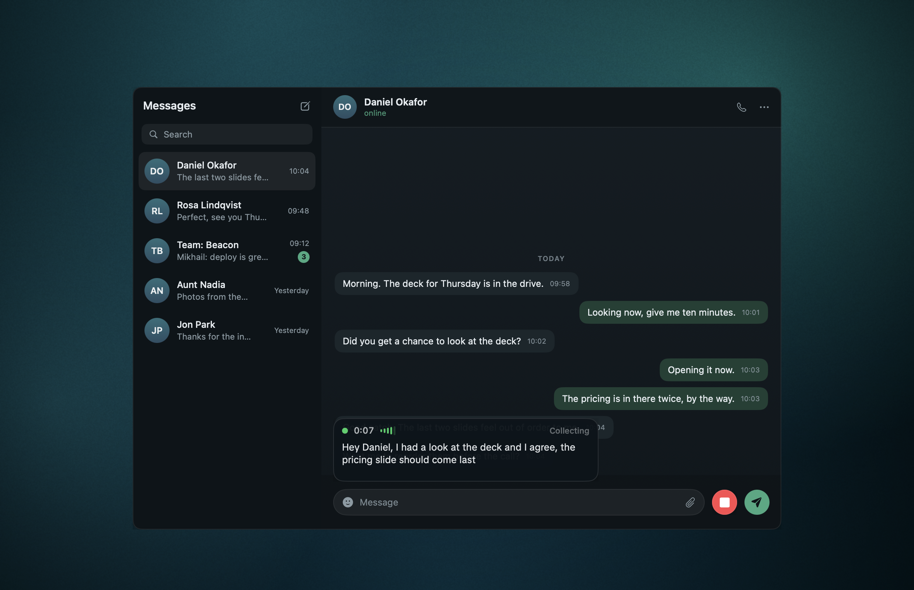
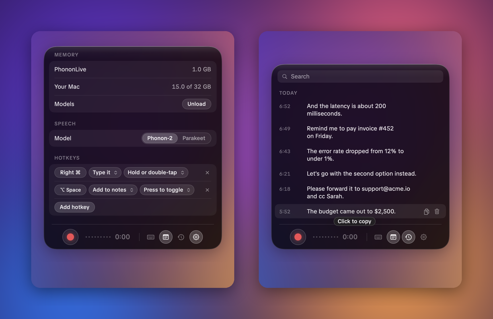

# Iridium Live

Dictation app for macOS. Speech recognition runs locally on the GPU with
[Phonon-2](https://huggingface.co/FermionResearch/Phonon-2).



## Features

- **Captions:** live text at the top or bottom of the screen.
- **Typing** into the app in front. Misheard words are fixed while you speak.
- **Notes:** dictate into a note and edit it like any text. Saved notes are in My notes.
- **Hotkeys:** hold, double-tap or toggle. Several hotkeys can share a key.
- **Microphone:** the MacBook's own. While the lid is closed, your default input, such as AirPods or a USB microphone.
  If no sound arrives, the status line says so.
- **WhatsApp and Telegram:** a record button in the chat window. Stream mode types while you speak. Collect mode
  inserts the whole message at the end and can send it.
- **AI cleanup** (optional, Groq or OpenRouter): removes filler words and formats numbers, dates and links. Custom
  instructions.
- **Models window:** every OpenRouter model and provider with latency, throughput, price, context and uptime, measured
  per provider. Sort, resize, reorder, show or hide any column. Star a model and provider to save it to My models,
  then pick from the last three in Settings.
- **Corrections:** say "Let's meet on Tuesday", then "I mean Wednesday", and "Tuesday" becomes "Wednesday", also in
  the typed text. Works with correction keywords such as "I mean", "no wait" and "scratch that".
- **Add quotes** (optional): "quote … end quote" becomes quotation marks.
- **When cleanup fails:** retry, fail and notify, or insert the raw text. An answer cut off at its length limit, or
  containing model markers such as `<EOS_TOKEN>`, is never typed; what you said is typed instead.
- **History:** everything dictated, searchable, with timing and cost. Play what you said (with *Save audio* on), retry
  the cleanup of any entry or add it to the current note.
- **Out of the way:** right-click the control to make it compact (one thin line) or hide it for 15 minutes, an hour
  or until you show it again. Hotkeys keep working while it is hidden.
- **Menu bar icon:** start dictation, record a meeting, show or hide the control, quit. It turns red while recording.





## Meetings

Record a meeting with your microphone and the other side of the call, with a live transcript while it runs and a
full transcript with speakers afterwards. The meeting button in the bar opens the meeting pane, where you choose the
microphone, system audio and engine and press Record. While a meeting records, a strip under the bar shows the time
and the last thing said, with Pause and Stop, even with the pane closed. Dictation keeps working during a meeting,
and the live transcript leaves out what your microphone picks up from your speakers.
Speakers can be renamed and merged, lines can be edited and played back, and a meeting can be exported as Markdown,
SRT, VTT or text.

Engines: Apple on this Mac (default), Parakeet on this Mac, or ElevenLabs, AssemblyAI and Deepgram with a key. Any
meeting can be transcribed again with another engine. The live transcript uses Apple on device speech. Summaries,
action items and chat use OpenRouter or Anthropic.

Meetings live in `~/Library/Application Support/Iridium Live/Meetings`, one folder per meeting with its audio,
transcript and summary. Meetings from the old Iridium app are copied in once, after first launch.

## Numbers

M1 Max, 32 GB.

| | |
|---|---|
| Speed | 79x realtime |
| Word error rate | 8.18% (Open ASR Leaderboard, 300 clips) |
| Phonon-2 vs Parakeet TDT v3 | 9.28% vs 9.27% word error rate, 86x vs 58x realtime |
| Pause that splits speech | 0.7 s |
| Cleanup, Groq with Qwen3.8 27B | 143 ms median |
| Corrections test, Qwen3.8 27B on Cerebras (OpenRouter) | 22 of 22 corrections right, 0 wrong edits, 0 of 20 look-alikes changed, 284 ms median |
| Memory | 1.0 GB with the speech model loaded, 0.5 GB unloaded |

English only.

## Install

Requirements: Apple silicon, macOS 26, Xcode command line tools, [uv](https://docs.astral.sh/uv/).

```sh
make install   # build and copy to /Applications
make run       # run from the terminal
make check     # print the paths the app uses
make cert      # create a local signing certificate, so permissions survive rebuilds
```

On first launch the app asks for Microphone and Accessibility access. API keys are optional and stored in the login
keychain. The speech model (about 1 GB) downloads on first use.

## Privacy

- Audio stays on your Mac. Audio is saved only with Save audio on, or when cleanup fails.
- With AI cleanup on, text is sent to Groq or OpenRouter: the new text, the earlier text of the same recording, and
  the end of the current note.

## Files

`~/Library/Application Support/Iridium Live`

| | |
|---|---|
| `notes.txt` | unsaved note |
| `Notes/` | saved notes |
| `journal.txt` | everything dictated, in order |
| `backups/` | earlier versions of notes |
| `history.jsonl` | history with timing |
| `usage.jsonl` | AI model calls: tokens, cost, time |
| `Recordings/` | saved audio; `Failed/` holds audio whose cleanup failed |
| `Meetings/` | one folder per meeting: audio, transcript, summary |
| `chat-apps.json` | chat app settings |

Engine log: `~/Library/Logs/Iridium Live/engine.log`

## Code

| | |
|---|---|
| `Sources/` | the app (SwiftUI) |
| `live.py` | the speech engine (Python, MLX), run by the app as a child process |
| `segmenter.py` | voice detection; splits speech at pauses |
| `asr.py` | Phonon-2 and Parakeet |
| `cleanup.py` | AI cleanup with Groq and OpenRouter |
| `archive.py` | saves audio |
| `downloads.py` | downloads the speech model |
| `Packages/ModelCatalog` | Swift package: `OpenRouterCatalog` (models, providers, stats) and `SortableTable` (sortable SwiftUI table) |
| `Packages/MeetingKit` | Swift package: meeting recording, transcription, summaries |

## Credits

- [Phonon-2](https://huggingface.co/FermionResearch/Phonon-2) by Fermion Research (CC-BY-4.0), from NVIDIA's
  [Parakeet TDT 0.6B v3](https://huggingface.co/nvidia/parakeet-tdt-0.6b-v3) (CC-BY-4.0)
- [Silero VAD](https://github.com/snakers4/silero-vad) (MIT)
- [mlx-audio](https://github.com/Blaizzy/mlx-audio) (MIT)
- [TikTok Sans](https://github.com/tiktok/TikTokSans) (SIL Open Font License, in `fonts/`)
- [LobeHub icons](https://github.com/lobehub/lobe-icons) (MIT, in `Packages/ModelCatalog/Brands/`): model maker and
  provider logos
- [FluidAudio](https://github.com/FluidInference/FluidAudio) (Apache 2.0): speaker detection and Parakeet for
  meetings
